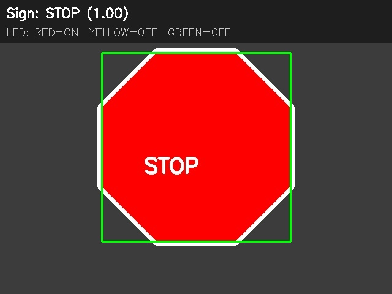
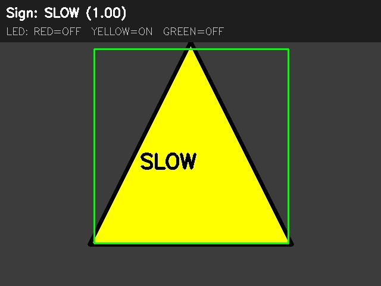
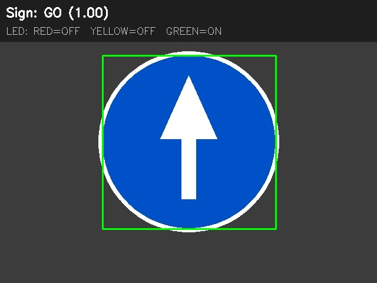
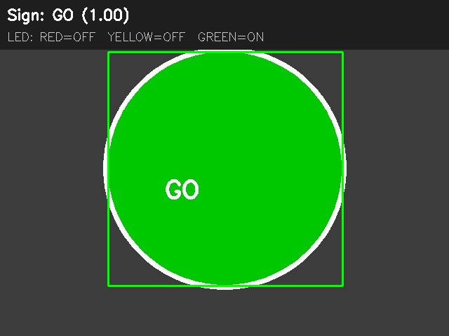
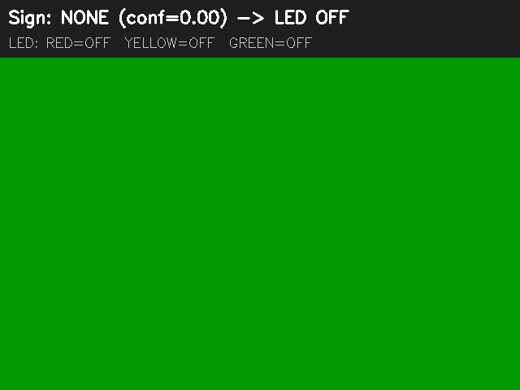

# Traffic Sign Recognition → LED Control (Jetson Nano)

Sistem pengenalan rambu lalu lintas otomatis berbasis **NVIDIA Jetson Nano** dan kamera.
Pipeline: **Camera → Sign Recognition → Decision Logic → GPIO → LED**.

Sistem mengenali minimal **3 jenis sign** (STOP, SLOW, GO) dan menyalakan **3 LED** sesuai
keputusan. Jika tidak ada sign atau confidence di bawah threshold, **semua LED mati**
(default `SAFE_STATE = "NONE"`; bisa diubah ke `"STOP"` untuk safe-state merah).

---

## 1. Ringkasan

| Komponen | Metode |
|----------|--------|
| Pengenalan sign | Computer Vision: deteksi warna (HSV) + analisis bentuk kontur (segi-8, segi-3, lingkaran/persegi; GO hijau atau biru+panah putih) |
| Keputusan | Decision engine dengan konfirmasi temporal (N frame berturut) + safe-state fallback |
| Aktuator | 3 LED via GPIO Jetson Nano (Jetson.GPIO) |
| Antarmuka | Preview OpenCV (bbox + label + confidence + status LED) + log terminal |

**Mengapa Computer Vision (bukan CNN)?**
Deteksi warna+bentuk cukup andal untuk 3 sign dengan warna kontras (merah/kuning/hijau/biru),
ringan di compute (Jetson Nano), dan mudah dikalibrasi. Arsitektur modular —
`src/sign_recognition.py` dapat diganti dengan CNN/MobileNet/YOLO tanpa mengubah
decision logic atau GPIO (lihat §7).

---

## 2. Spesifikasi Hardware

| Item | Spesifikasi | Keterangan |
|------|-------------|------------|
| SBC | NVIDIA Jetson Nano (4GB) | JetPack 4.x / 5.x, Python 3.6+ |
| Kamera | USB webcam atau CSI ( Raspberry Pi Camera v2 / module ) | 640×480 @ 30fps cukup |
| LED Merah | 1× LED + resistor 220Ω | STOP |
| LED Kuning | 1× LED + resistor 220Ω | SLOW |
| LED Hijau | 1× LED + resistor 220Ω | GO |
| Breadboard + jumper | — | Rangkaian uji |
| Monitor + keyboard | Opsional | Untuk preview & kontrol |

### Pin GPIO Jetson Nano (BOARD mode)

| LED | GPIO (BCM) | Header Pin (BOARD) |
|-----|------------|--------------------|
| Merah (STOP) | GPIO17 | **11** |
| Kuning (SLOW) | GPIO27 | **13** |
| Hijau (GO) | GPIO23 | **16** |
| GND (semua LED) | GND | **6 / 9 / 14 / 20 / 25** |

> Catatan: pin dapat diubah di `config.py` (`LED_RED_PIN`, `LED_YELLOW_PIN`, `LED_GREEN_PIN`).
> Di Jetson ini **pin 15 (GPIO22) dipakai driver fan/carrier board**, sehingga LED hijau
> memakai **pin 16 (GPIO23)**.

---

## 3. Spesifikasi Software

| Software | Versi / Catatan |
|----------|-----------------|
| OS | Ubuntu 18.04/20.04 (JetPack) atau Ubuntu 20.04+ (dev) |
| Python | 3.6+ (Jetson Nano default 3.6; dev bisa 3.8+) |
| OpenCV | `opencv-python` atau preinstall JetPack (`cv2`) |
| NumPy | ≥ 1.19 |
| Jetson.GPIO | ≥ 2.0 (khusus Jetson; fallback mock di non-Jetson) |
| pytest | Opsional, untuk unit test |

Dependensi: `requirements.txt`.

---

## 4. Cara Kerja Sistem

```
┌─────────┐   frame    ┌──────────────────┐   SignResult   ┌─────────────────┐
│ Camera  │ ─────────► │ Sign Recognition │ ─────────────► │ Decision Logic  │
└─────────┘            │ (HSV + shape)    │ sign,conf,bbox │ (temporal filter│
                       └──────────────────┘                │  + safe-state)  │
                                                           └────────┬────────┘
                                                                    │ sign
                                                                    ▼
┌─────────┐   GPIO     ┌──────────────────┐                  ┌──────────────┐
│   LED   │ ◄───────── │  GPIO Controller │ ◄────────────────│   Decision   │
│ R/Y/G   │            │  (Jetson.GPIO)   │                  └──────────────┘
└─────────┘            └──────────────────┘
```

### Alur per frame
1. **Capture** — ambil frame dari kamera (640×480).
2. **Recognition** — konversi ke HSV, buat mask per warna (merah/kuning/hijau/biru),
   temukan kontur, klasifikasi bentuk (segi-8=STOP, segi-3=SLOW, lingkaran/rect=GO;
   GO biru dengan panah putih juga dikenali), hitung **confidence** dari kombinasi
   warna+bentuk+ukuran.
3. **Decision** — sign hanya diterima jika muncul **N frame berturut** (konfirmasi
   temporal, menghilangkan flicker). Jika confidence < threshold atau tidak ada kontur →
   **semua LED mati** (`SAFE_STATE = "NONE"`).
4. **GPIO** — LED dinyalakan sesuai keputusan (hanya satu LED nyala).
5. **Display** — bbox + label sign + confidence + status LED ditampilkan (jendela OpenCV
   dan/atau log terminal).

### Confidence & Threshold
- `MIN_CONFIDENCE` default **0.55** (di `config.py`, bisa via `--min-conf`).
- Skor confidence = `0.30·color + 0.60·shape·shape_score + 0.10·size` (0–1).
- Tahan LED terakhir: `SAFE_HOLD_SECONDS = 0.5` dtk (tahan sebentar agar tidak
  flicker saat tanda berganti).

### Kondisi tanpa tanda (tidak ada sign)
- Tidak ada sign terdeteksi → **semua LED mati** (`SAFE_STATE = "NONE"`).
- Confidence < threshold → **semua LED mati**.
- Ingin safe-state merah (fail-safe kendaraan)? Ubah `SAFE_STATE = "STOP"` di `config.py`.
- Kamera gagal baca frame → pipeline berhenti & LED di-cleanup (all OFF).

---

## 5. Wiring (Rangkaian)

```
Jetson Nano Header                LED Circuit
─────────────────                 ───────────
Pin 11 (GPIO17) ──[220Ω]──►|◄──┐  LED Merah (STOP)
Pin 13 (GPIO27) ──[220Ω]──►|◄──┤  LED Kuning (SLOW)
Pin 16 (GPIO23) ──[220Ω]──►|◄──┤  LED Hijau (GO)
                              │
GND (Pin 6) ──────────────────┘
```

- **Resistor 220Ω** seri dengan anode LED; katode ke GND.
- polarity: GPIO HIGH → LED nyala (`LED_ACTIVE_HIGH = True`). Ubah ke `False` jika
  rangkaian aktif-LOW (LED ke VCC, resistor ke GPIO).
- Diagram lebih rinci: [`docs/WIRING.md`](docs/WIRING.md).

---

## 6. Instalasi & Menjalankan

### 6.1 Di Jetson Nano (produksi)
```bash
# clone
git clone https://github.com/raisfadillahh/AI-For-Robotic_Kelompok8.git
cd AI-For-Robotic_Kelompok8

# install dependensi
pip3 install -r requirements.txt
# (atau: sudo apt install python3-opencv python3-numpy)

# jalankan dengan kamera nyata + GPIO
python3 src/main.py

# nonaktifkan jendela preview (headless)
python3 src/main.py --no-preview
```

### 6.2 Mode mock (tanpa hardware — untuk demo / CI / development)
```bash
python3 src/main.py --mock
```
Menjalankan simulasi urutan sign (STOP→SLOW→GO→NONE→STOP) dan mencetak status LED
tanpa membutuhkan kamera atau GPIO fisik.

### 6.3 Uji satu gambar statis
```bash
python3 src/main.py --image assets/signs/stop.jpg
```

### 6.4 Unit test
```bash
python3 -m pytest tests/ -v
# atau tanpa pytest:
python3 tests/test_pipeline.py
```

### Argumen CLI
| Argumen | Fungsi |
|---------|--------|
| `--mock` | Mode simulasi (tanpa kamera/GPIO) |
| `--image PATH` | Proses satu gambar |
| `--save PATH` | Simpan hasil anotasi (berguna via SSH/headless) |
| `--method color_shape\|yolo` | Metode pengenalan (default `color_shape`) |
| `--no-preview` | Matikan jendela OpenCV |
| `--min-conf FLOAT` | Threshold confidence (default 0.55) |

Contoh uji gambar via SSH tanpa jendela:
```bash
python3 src/main.py --image foto_stop.jpg --no-preview --save results/out_stop.jpg
```

### 6.5 Model AI (YOLOv8) — opsional
Model hasil training ada di `models/best.pt` (YOLOv8, 3 kelas: `GO`, `SLOW`, `STOP`).
Jalankan dengan:
```bash
python3 src/main.py --method yolo
```
- **Butuh Python ≥ 3.8** dan paket `ultralytics` (`pip install ultralytics`).
- Di Jetson dengan **Python 3.6.9** (JetPack lama) `ultralytics` belum bisa dipasang;
  `--method yolo` akan otomatis **fallback ke `color_shape`** dengan pesan
  `[MODEL] Gagal load YOLO ...`. Metode `color_shape` sudah cukup untuk demo UTS.
- Model dimuat dari `config.MODEL_PATH`; mapping kelas di `config.MODEL_CLASS_MAP`.

### 6.6 Deteksi `color_shape` (default, cepat)
Tiga perbaikan utama:
1. **Bentuk dari convex hull** → teks/border/ikon di dalam tanda tidak merusak bentuk.
2. **Fill-ratio** (luas hull ÷ luas lingkaran pembungkus) memisahkan bentuk dengan
   jelas: segitiga ≈0.43, persegi ≈0.65, oktagon ≈0.90, lingkaran ≈1.00. Lebih
   stabil daripada menghitung jumlah vertex saja.
3. **Deteksi pada lebar `PROCESS_WIDTH = 320`** (downscale `INTER_AREA`) lalu bbox
   dikembalikan ke skala frame asli. Kernel morfologi memakai **persegi** (separable)
   yang jauh lebih cepat di Jetson daripada ellipse.

Skor = `0.30·warna + 0.60·bentuk + 0.10·ukuran`. **Bentuk wajib cocok**
(STOP=oktagon, SLOW=segitiga, GO=lingkaran/persegi); jika tidak, skor maksimum 0.40
< threshold 0.55 → ditolak. Jadi objek hijau/biru/merah/kuning sembarang tidak lolos.

**GO biru + panah putih:** selain GO hijau, tanda GO biru dengan panah putih juga
dikenali. Panah putih (saturasi rendah) tidak masuk mask, sehingga kontur luar tetap
berbentuk lingkaran/persegi. Range biru ada di `HSV_RANGES["blue"]` dan dipetakan ke
GO melalui `COLOR_TO_SIGN`.

Tuning di `config.py`:
| Variabel | Default | Fungsi |
|----------|---------|--------|
| `PROCESS_WIDTH` | 320 | lebar kerja deteksi (`0` = full frame) |
| `MIN_AREA_RATIO` | 0.004 | area kontur minimum relatif frame |
| `STABLE_FRAMES` | 2 | jumlah frame konfirmasi (kecil = lebih responsif) |
| `HSV_RANGES` | — | range warna; kalibrasi via `tools/hsv_calibration.py` |

Benchmark & uji batch gambar:
```bash
python3 tools/benchmark_detection.py --bench          # ukur FPS
python3 tools/benchmark_detection.py --dir fotoku     # uji semua gambar
python3 tools/benchmark_detection.py --dir fotoku --expect STOP
```
Hasil terukur di Jetson ini: **~29 ms/frame (≈34 FPS)** untuk recognizer 640×480
(sebelumnya ~70 ms / ~14 FPS; kamera membatasi end-to-end ke ±30 FPS), akurasi
**56/56** pada uji sintetis (normal, jauh, dekat/terpotong, blur, rotasi ±12°,
perspektif, gelap/terang, pudar, hue ±8, noise, resolusi 320) untuk STOP, SLOW,
GO hijau, dan GO biru+panah.


---

## 7. Struktur Repositori

```
kelompok8/
├── README.md                  ← dokumen ini
├── config.py                  ← konfigurasi (pin, HSV, threshold, dsb)
├── requirements.txt
├── models/
│   └── best.pt                ← model YOLOv8 (kelas GO/SLOW/STOP, opsional)
├── src/
│   ├── main.py                ← pipeline utama (camera→recognize→decide→GPIO)
│   ├── camera.py              ← GStreamer (CSI) + V4L2 (USB) + flip
│   ├── sign_recognition.py    ← color+shape heuristic & loader YOLO
│   ├── decision_logic.py      ← konfirmasi temporal + safe-state
│   └── gpio_control.py        ← Jetson.GPIO + mock fallback
├── tests/
│   └── test_pipeline.py       ← unit test (decision, GPIO, recognizer)
├── tools/
│   ├── hsv_calibration.py     ← kalibrasi HSV
│   ├── capture_signs.py       ← ambil contoh frame nyata + diagnosis
│   └── benchmark_detection.py ← benchmark FPS + uji batch gambar
├── docs/
│   ├── ARCHITECTURE.md        ← arsitektur sistem (detail)
│   └── WIRING.md              ← diagram rangkaian + kalibrasi HSV
├── assets/
│   └── signs/                 ← gambar contoh sign (untuk --image & dokumentasi)
└── results/                   ← screenshot & log pengujian
```

### Ekstensi ke AI/CNN
`src/sign_recognition.py` mengembalikan objek `SignResult`. Untuk mengganti dengan
CNN (mis. MobileNet / YOLO), cukup ganti isi fungsi `recognize()` agar memuat model
dan mengembalikan `SignResult(sign, confidence, bbox)`. Decision logic & GPIO tidak
berubah.

---

## 8. Hasil Pengujian

Dokumentasi pengujian lengkap (jarak, pencahayaan, pergantian sign, no-sign) ada di
[`results/`](results/) dan ringkasan di bawah. **Isi tabel berikut saat pengujian nyata.**

### 8.1 Pengujian per sign @ 3 jarak
| Sign | 30 cm | 50 cm | 100 cm | LED sesuai? |
|------|-------|-------|--------|-------------|
| STOP (merah, segi-8) | | | | ☐ |
| SLOW (kuning, segi-3) | | | | ☐ |
| GO (biru + panah putih / hijau) | | | | ☐ |

### 8.2 Pengujian 2 kondisi pencahayaan
| Sign | Terang | Redup | Catatan |
|------|--------|-------|---------|
| STOP | | | |
| SLOW | | | |
| GO | | | |

### 8.3 Pergantian sign & no-sign (safe state)
| Skenario | Hasil ekspektasi | Hasil aktual |
|----------|------------------|--------------|
| STOP → SLOW | LED merah→kuning | |
| SLOW → GO | LED kuning→hijau | |
| GO → tidak ada sign (>0,5 dtk) | LED hijau→semua mati | |
| confidence < threshold | semua LED mati | |

### 8.4 Log mock (verifikasi otomatis)```
input=STOP conf=0.92 → decision=STOP safe=False LED={'red': True,  ...}
input=SLOW conf=0.88 → decision=SLOW safe=False LED={'yellow':True, ...}
input=GO   conf=0.91 → decision=GO   safe=False LED={'green':True, ...}
input=NONE conf=0.10 → decision=NONE safe=True  LED=semua OFF
input=STOP conf=0.95 → decision=STOP safe=False LED={'red': True,  ...}
```
*Jalankan `python3 src/main.py --mock` untuk mereproduksi.*

### 8.5 Screenshot hasil (overlay preview + status LED)

| STOP (merah) | SLOW (kuning) | GO (biru + panah putih) |
|---|---|---|
|  |  |  |

| GO (hijau) | Tanpa tanda (semua LED mati) |
|---|---|
|  |  |

> Gambar di atas adalah hasil **sintetis** (dibuat dengan `tests/test_pipeline.py`).
> Foto tanda & LED fisik asli diisi setelah uji lapangan — lihat
> [`results/TEST_LOG.md`](results/TEST_LOG.md).

---

## 9. Troubleshooting

| Gejala | Solusi |
|--------|--------|
| `ModuleNotFoundError: cv2` | `pip3 install opencv-python` atau gunakan JetPack preinstall |
| `Jetson.GPIO` warning carrier board | Normal di board non-resmi; library tetap dipakai. Jika akses GPIO gagal, program fallback ke mock |
| LED tidak nyala | Cek pin di `config.py`, polaritas LED, resistor, dan `LED_ACTIVE_HIGH` |
| LED hijau tidak nyala di pin 15 | Pin 15/GPIO22 dipakai driver fan di board ini → pindahkan ke **pin 16/GPIO23** (sudah default di `config.py`) |
| Kamera CSI tampil **hijau** | Kamera CSI wajib GStreamer: pastikan `USE_GSTREAMER_CAMERA = True` dan paket `python3-gi` terpasang (lihat `docs/WIRING.md`) |
| `findContours` ValueError | OpenCV 3.x mengembalikan 3 nilai — kode sudah kompatibel (3.x & 4.x) |
| Sign tidak terdeteksi | Kalibrasi ulang `HSV_RANGES` di `config.py` sesuai pencahayaan (lihat docs/WIRING.md §Kalibrasi) |
| Deteksi flicker | Naikkan `stable_frames` di `DecisionEngine`, atau naikkan `MIN_CONFIDENCE` |
| Preview tidak muncul (SSH) | Gunakan `--no-preview` atau X11 forwarding |

---

## 10. Anggota Kelompok

| Nama | NIM |
|------|-----|
| | |
| | |
| | |

> _Isi nama & NIM anggota kelompok di tabel above._
| | |

---

## Lisensi
MIT — silakan dipakai untuk tugas UTS.
